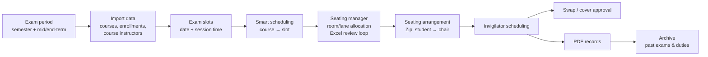
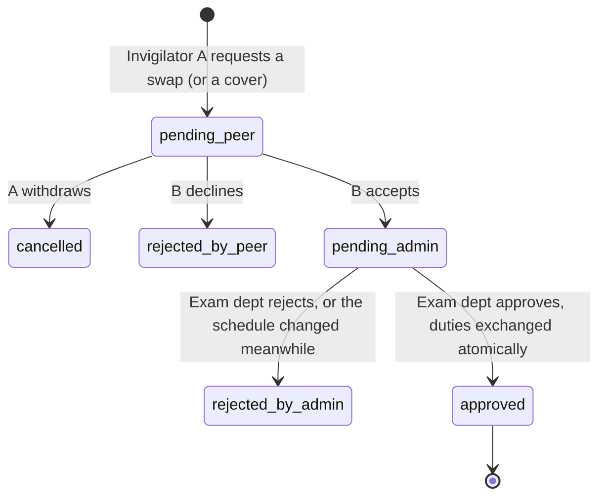
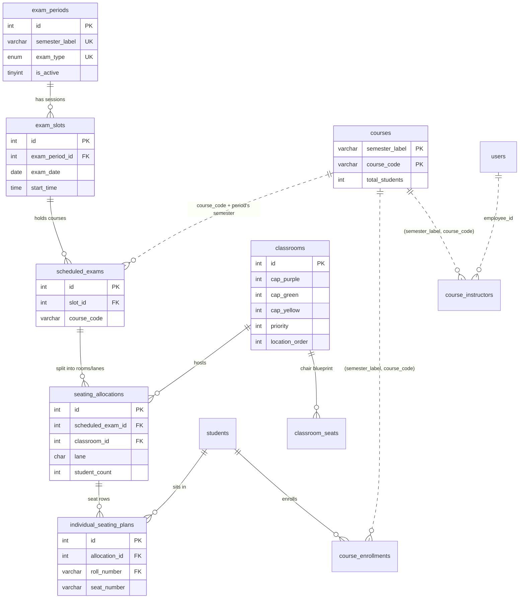
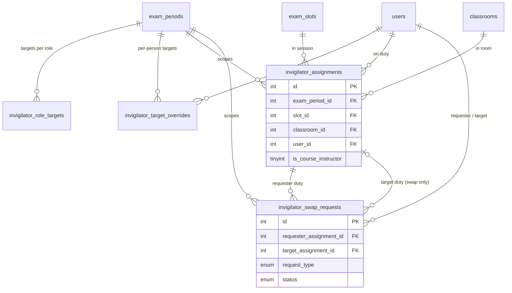
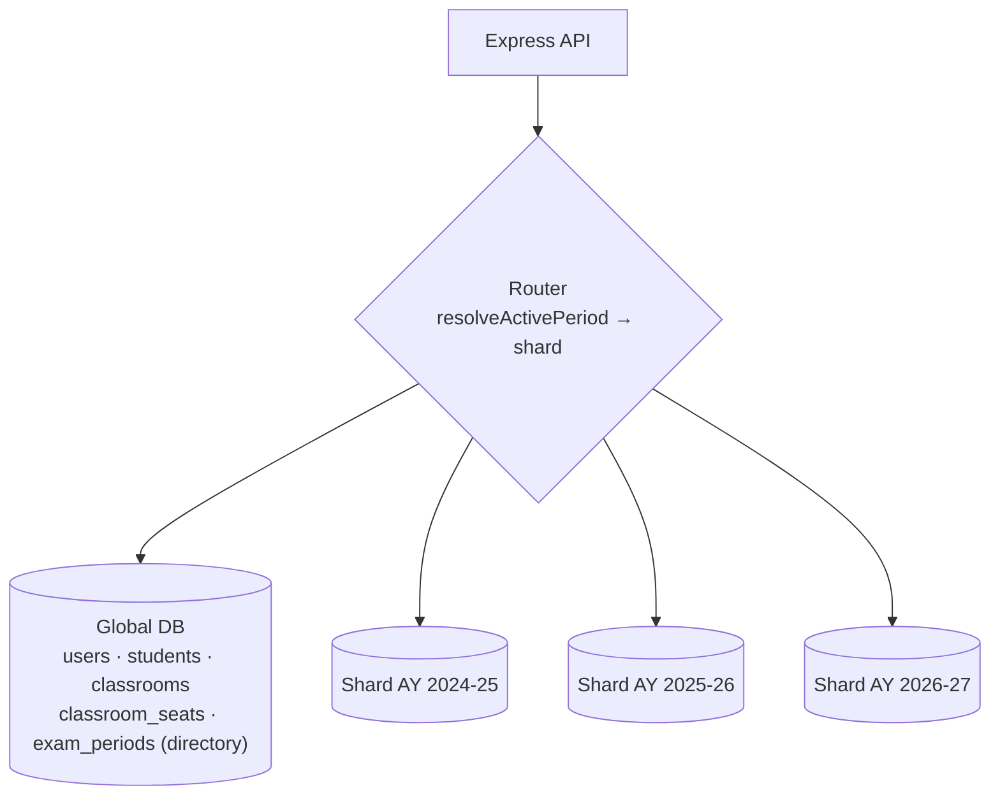

# Examination Seating & Invigilation Management System — Interview Notes

> **Read this box before the interview.** Three things in the story need to match what the code
> actually does, because an interviewer may open the repository:
>
> 1. **The final seating algorithm in the repo is the two-phase heuristic** (rooms start Purple,
>    then "fracture" to Green/Yellow by priority, then fill in building/location order) —
>    `backend/utils/seatingAlgorithm.js`. The scoring (reward/penalty) model is **not** in the
>    repository. Either add it before you present it as the final version, or present the scoring
>    model as *how you reasoned about the trade-offs* and the heuristic as *what runs in production*
>    (Section 3.4 is written that way).
> 2. **Say "scoring / utility function inspired by game theory", not "game theory".** A weighted
>    reward-and-penalty objective is an optimisation technique. Game theory proper is about several
>    strategic players and equilibria, and an interviewer may ask "who are the players?".
> 3. **What is implemented is semester-based *partitioning*, not sharding.** Everything lives in one
>    MySQL database; every table and query is scoped by semester / exam period, so the data is
>    *shard-ready*. Section 10 explains the difference and how real sharding would be done.

---

## 0. The 30-second pitch

1. I built an end-to-end examination management system for my college (LNMIIT, Jaipur).
2. It takes the course and enrollment data and produces **room-wise seating plans**, a
   **seat-by-seat seating chart**, a **fair invigilator duty schedule**, and all the **printable
   documents** (attendance sheets, duty charts, duty letters).
3. The core is a **constraint-based seating allocator**: every student must be seated, rooms use
   different spacing patterns, and a course should be split across as few rooms and buildings as possible.
4. I also replaced an informal duty-swapping process with a **3-way approval workflow**
   (requester → colleague → examination department).
5. Result: exam preparation dropped from **14–16 hours to 2–3 hours** per exam cycle.

**Stack:** React 19 + Vite + Tailwind · Node.js/Express · MySQL 8 · JWT auth · jsPDF / ExcelJS ·
180+ automated tests (unit, integration, component) plus Playwright end-to-end tests in GitHub Actions CI.

---

## 1. The problem

1. **Two examination buildings:** the **Academic Hall** and the **Incubation Centre**. Each has
   several zones, and each zone has Lecture Theatres (LTs).
2. **Goal:** for every exam session, seat every student of every exam held in that session.
3. **The manual process took 14–16 hours per exam cycle:** spreadsheets, hand-counting capacities,
   then writing duty charts and attendance sheets by hand.
4. **Invigilator duty swaps happened informally** between faculty members, and the examination
   department often learned about them at the last minute. Nobody had a reliable record of who was
   actually on duty.

---

## 2. Requirements and constraints

### 2.1 Seating patterns (per Lecture Theatre)

| Pattern | Layout | Courses per lane |
|---|---|---|
| **Purple** | Students sit with **two empty seats** between them. Most spacious, lowest capacity. | One course for the whole room |
| **Green / Yellow (split)** | Seats alternate Green, Yellow with **one gap** between. Higher capacity. | A course gets **only one colour** in a given room |

Each room stores its own capacity for each pattern (`cap_purple`, `cap_green`, `cap_yellow`),
so **different rooms can use different patterns** in the same session.

### 2.2 Hard constraints (must hold)

1. **Every exam scheduled in a session must be fully seated.** This is the primary constraint.
2. **Only rooms available that day/session may be used.** Some LTs are unavailable on some days.
3. **A course occupies only one colour within a room.** It never sits in both the Green and Yellow lanes of the same LT.
4. **Room capacity per pattern is never exceeded.**

### 2.3 Soft constraints (optimise)

1. **Minimise fracturing:** split a course across as few LTs as possible. During the exam a
   correction or announcement may have to be carried to every room of that course, so fewer rooms
   means less walking for invigilators.
2. **Avoid splitting a course across the two buildings** whenever possible.
3. **Prefer Purple** (more spacing) whenever capacity allows.

---

## 3. How the seating algorithm evolved

### 3.1 Version 1 — if/else rules (failed)
- Hand-written conditions for each case ("if the course is bigger than the room, then…").
- It broke down as soon as constraints interacted: fixing one case (capacity) broke another
  (fracturing). The number of combinations grew too fast to cover by hand.

### 3.2 Version 2 — state-machine approach
- Every room starts in the **Purple** state.
- If total demand exceeds total Purple capacity, rooms move to the **Split (Green/Yellow)** state
  one at a time until there is enough capacity.
- This solved the *capacity* problem, but the first version did not control *fracturing* well.

### 3.3 Version 3 — scoring model (how the trade-offs were reasoned about)
- Inspired by the **payoff functions** in my *Game Theory* programme elective: score every candidate
  plan and prefer the higher score.
- Shape of the objective *(fill in the weights you actually used)*:

  ```
  score(plan) =  + α · (rooms kept in Purple)
                 − β · Σ over courses (number of rooms the course uses − 1)        ← fracturing
                 − γ · Σ over courses (number of buildings the course uses − 1)    ← building split
                 − M · (students left unseated)                                    ← M ≫ α, β, γ ("big-M")
  ```
- The very large penalty `M` effectively turns "seat everyone" into a hard constraint: no amount
  of Purple reward can make leaving a student unseated worthwhile.

### 3.4 What runs in production (`backend/utils/seatingAlgorithm.js`)
These priorities are encoded in a fast, deterministic **two-phase greedy heuristic**:

1. **Filter rooms** to those enabled for this session (per-session room availability).
2. **Phase 1, capacity planning:**
   - Start every room in Purple. Total capacity = Σ `cap_purple`.
   - If demand > capacity, convert rooms to Split mode **in priority order** (the admin ranks which
     rooms are best to convert), adding `cap_green + cap_yellow − cap_purple` each time, and stop
     as soon as capacity ≥ demand. So **only as many rooms as necessary** give up Purple.
   - "Sticky" rooms never convert; rooms with no Purple layout are always Split.
3. **Re-sort rooms by `location_order`.** Rooms are numbered building by building and zone by zone,
   so walking this order keeps a course inside one building and in neighbouring rooms.
4. **Phase 2, allocation:** courses are placed **largest first**:
   - **Purple room:** the course fills the room (one course per room).
   - **Split room:** the largest course takes the **Green** lane; other courses take **Yellow**. A
     course already in one colour of a room is never put in the other colour (hard constraint 3).
   - An **overflow pass** uses any remaining free lanes if a course still has students left.
   - Anything still unseated is logged as **CRITICAL**, so the plan cannot silently drop students.
5. **Human in the loop:** the plan is exported to **Excel** (one sheet per session, colour-coded,
   with a machine-readable key row). The exam office can adjust it, then upload it back. The
   upload replaces the allocations in the database.

**Why this minimises fracturing:** largest-first plus filling rooms in physical order means each
course occupies a *contiguous run* of rooms, as few as room sizes allow, usually in one building.
Purple rooms never mix courses.

**Complexity:** about O(C × R) per session (C = courses, R = rooms). It runs in milliseconds.

### 3.5 Seat-level plan — the "Zip" step
- For each room and lane, the physical chairs are stored in walking order (`classroom_seats.seq_order`).
- Students of each course are sorted by roll number and **zipped** onto the chairs one-to-one,
  continuing from the next free chair when several courses share a lane.
- The output is one row per student: room, lane, seat number. This feeds the attendance sheets.

### 3.6 Why no AI at runtime
- The college required the system to run **offline / on-premises** (no external AI services), and
  local models on available PCs were not reliable enough.
- AI was used only as a **design aid** while building the algorithm. The scheduler itself is
  deterministic: same input, same output, and easy to explain to the exam office.

---

## 4. The full workflow (admin side)



Points to walk through:
1. Everything is scoped to an **exam period** (e.g. *EVEN 2025-2026 / Mid-term*). Each semester has
   a mid-term and an end-term period.
2. **Import:** course master (.xlsx), enrollments (.zip of per-course .xlsx files), and the
   course → instructor mapping. The system reports mismatches between expected and actual
   enrollment counts.
3. **Slots** are created per period; **smart scheduling** assigns courses to slots.
4. **Seating manager** runs the allocator per slot with that slot's available rooms → Excel review → upload.
5. **Seating arrangement** runs the Zip step to produce seat numbers.
6. **Invigilation, swaps, documents and archiving** follow (sections 5–7).

---

## 5. Invigilator scheduling

1. **How many invigilators:** each room needs `max(1, ⌈students ÷ 25⌉)`.
2. **Phase A, course instructors first:** an instructor invigilates in a room where their own course
   is being written, so they can answer questions and serve corrections.
   - If a course has *k* instructors across *n* rooms (k < n), instructor *i* goes to room index
     `⌊(i + 0.5) · n / k⌋`. This spreads them evenly, so every room has an instructor nearby.
3. **Phase B, fill the rest fairly:** remaining positions go to whoever is **furthest below their duty
   target** (deficit-first). Ties are broken by role (faculty → PhD student → lab staff), then by id.
4. **Hard rule:** nobody is placed in two rooms in the same session. This is also enforced in the
   database by a unique key (section 8).
5. **Duty targets** are set per role per exam (with per-person overrides). **Carry-over** keeps the
   semester balanced: whoever did extra duties in the mid-term gets fewer in the end-term, and vice versa:
   `effective target = max(0, base target − balance from the other exam of the same semester)`.
6. The algorithm produces a **draft**. The admin reviews and edits it, then saves. A progress tracker
   shows when the schedule is complete (all rooms staffed).

---

## 6. Duty swap / cover workflow (3-way approval)

**Problem it solves:** swaps used to be arranged informally and reported late. Now every change is
requested, accepted and approved inside the system, so the exam department always has the true duty list.



1. **Swap:** A and B exchange duties. **Cover:** B takes over A's duty entirely (A then owes a duty,
   which carry-over accounts for).
2. **Approval chain:** requester → colleague → examination department. These are the three parties.
3. **Correctness under concurrency:**
   - Approval runs in a **database transaction** and locks the request and both duty rows
     (`SELECT … FOR UPDATE`, in id order to avoid deadlocks).
   - It **re-validates** before executing: is each person still on that duty, still in this exam period,
     and would the swap double-book anyone? If anything changed, the request is **auto-rejected
     with a reason** instead of corrupting the schedule.
   - Swapping two duties in the *same* session exchanges the **rooms**, not the people, so the
     "one room per person per session" unique key is never violated mid-transaction.

---

## 7. Automation and impact

1. **Generated documents:**
   - Course-wise and hall-wise **attendance sheets** with seat numbers.
   - **Invigilation duty chart** (session → room → invigilator, with a signature column).
   - **Invigilator-wise roster**.
   - **Formal duty letters** (one per person).
   - **Workload summary** (targets vs assigned).
   - **Room attendance sheets** for invigilators.
2. **Archives:** finished seating plans and duty schedules are saved as permanent snapshots
   ("Past Exams", "Past Invigilation").
3. **Invigilator portal:** faculty see their duties, request swaps and covers, and download their own duty letter.
4. **Impact:** **14–16 hours → 2–3 hours** of preparation per exam cycle (about 80–85% less), and no
   more last-minute duty confusion.
5. **Engineering quality:**
   - JWT authentication with role-based access (admin / invigilator).
   - bcrypt password hashing.
   - Rate-limited login and OTP endpoints; OTPs stored hashed.
   - Helmet security headers and a CORS allow-list.
   - Automated tests in CI.

---

## 8. Database schema

**20 tables in 6 groups.** MySQL 8, InnoDB, utf8mb4.

### 8.1 Tables

#### Identity
| Table | Key columns | Notes |
|---|---|---|
| `users` | **id** PK, email UK, employee_id UK, role ENUM(admin, faculty, phd_student, lab_staff), password_hash, department | Admins and invigilators in one table; role decides access. |

#### Period (the scoping backbone)
| Table | Key columns | Notes |
|---|---|---|
| `exam_periods` | **id** PK, semester_label, exam_type ENUM(midterm, endterm), is_active | UK (semester_label, exam_type). Exactly one row is active; almost every query is scoped through it. |

#### Academic data (per semester)
| Table | Key columns | Notes |
|---|---|---|
| `students` | **roll_number** PK, name, email, branch, section_name | Institution-wide roster (not per semester). |
| `courses` | **(semester_label, course_code)** composite PK, course_name, total_students | The same course code can exist in many semesters. |
| `course_enrollments` | id PK, roll_number FK → students, course_code, semester_label | UK (semester_label, course_code, roll_number); index on semester_label. |
| `course_instructors` | id PK, course_code, semester_label, employee_id | UK (semester_label, course_code, employee_id). Linked to `users` by employee_id. |

#### Infrastructure
| Table | Key columns | Notes |
|---|---|---|
| `classrooms` | id PK, room_name UK, cap_purple, cap_green, cap_yellow, priority, location_order, type | `priority` = order rooms are converted to Split; `location_order` = physical/building order; `type` 'sticky' = never converted. |
| `classroom_seats` | id PK, classroom_id FK, lane (P/G/Y), seat_number, seq_order | The physical chair blueprint used by the Zip step. |

#### Exam pipeline (per exam period)
| Table | Key columns | Notes |
|---|---|---|
| `exam_slots` | id PK, exam_period_id FK, exam_date, exam_day, start_time, end_time | One exam session. |
| `scheduled_exams` | id PK, slot_id FK, course_code | UK (slot_id, course_code): which course is written in which slot. |
| `seating_allocations` | id PK, scheduled_exam_id FK, classroom_id FK, lane, student_count, room_mode | **Output of the seating allocator:** "N students of course X in room R, lane G". |
| `individual_seating_plans` | id PK, allocation_id FK, roll_number FK, seat_number | **Output of the Zip step:** one row per student seat. |

#### Invigilation (per exam period)
| Table | Key columns | Notes |
|---|---|---|
| `invigilator_role_targets` | **(exam_period_id, role)** PK, target_duties | Default duty target per role. |
| `invigilator_target_overrides` | **(exam_period_id, user_id)** PK, override_target, note | Per-person exceptions. |
| `invigilator_assignments` | id PK, exam_period_id FK, slot_id FK, classroom_id FK, user_id FK, is_course_instructor | **UK (slot_id, user_id, exam_period_id)**: the database itself forbids double-booking. |
| `invigilator_swap_requests` | id PK, exam_period_id FK, requester_user_id FK, target_user_id FK, requester_assignment_id FK, target_assignment_id FK (NULL for covers), request_type, status, note, timestamps | The 3-way approval state machine (section 6). |

#### Archives (immutable snapshots)
| Table | Key columns | Notes |
|---|---|---|
| `exam_sessions` → `exam_session_seating` | session_id FK (cascade) | Denormalised copy of a finished seating plan (names, rooms, seats stored as text). |
| `invigilation_sessions` → `invigilation_session_duties` | session_id FK (cascade) | Denormalised copy of a finished duty schedule. |

### 8.2 Entity-relationship diagrams

Solid lines are real foreign keys. Dotted lines are **application-level** relationships (explained in 8.3).

**Exam and seating side**



**Invigilation side**



### 8.3 How the tables relate (talking points)

1. **`exam_periods` is the root.** Deleting a period cascades through its slots → scheduled exams →
   seating allocations → individual seats, and through its invigilator assignments → swap requests,
   targets and overrides. A whole exam can be removed cleanly in one statement.
2. **Two scoping keys:**
   - Course data (`courses`, `course_enrollments`, `course_instructors`) is keyed by **`semester_label`**,
     because the mid-term and end-term share the same courses and students.
   - Exam operations (`exam_slots`, `invigilator_*`) are keyed by **`exam_period_id`**.
   - `exam_periods` links the two: one semester label has two periods.
3. **Some relationships are application-level on purpose.** `courses` has a composite key
   (semester, code). Real foreign keys from enrollments and instructors would have to include
   `semester_label` everywhere, so integrity is enforced in the application and by **composite
   unique keys** instead.
4. **Shared master data:** `students`, `users` and `classrooms` are institution-wide and shared by all periods.
5. **Integrity enforced by the database itself:**
   - `UK(slot_id, user_id, exam_period_id)`: no double-booked invigilator.
   - `UK(slot_id, course_code)`: a course is scheduled at most once per slot.
   - `UK(semester_label, course_code, roll_number)`: no duplicate enrollment.
6. **Archives have no foreign keys to live tables** (only to their own session row). They are
   self-contained snapshots, so clearing or re-planning a live exam never alters history.

---

## 9. How the logic maps to the schema

| Step / algorithm | Reads | Writes | Enforced by the schema |
|---|---|---|---|
| Period setup | — | `exam_periods`, `invigilator_role_targets` | One (semester, exam type) pair per period |
| Import | Excel/zip files | `courses`, `students`, `course_enrollments`, `course_instructors` | Composite keys stop duplicates on re-upload |
| Slots + smart scheduling | `courses` | `exam_slots`, `scheduled_exams` | `UK(slot_id, course_code)` |
| **Seating allocator** (Purple/Split, largest-first, location order) | `classrooms` (capacities, priority, location_order), `scheduled_exams` + `courses.total_students` | `seating_allocations` (room, lane, count, mode) | Lane per row means one colour per course per room |
| Excel review loop | uploaded .xlsx | replaces the period's `seating_allocations` | Scoped delete by period, inside one transaction |
| **Zip** (student → chair) | `seating_allocations`, `course_enrollments` (by semester), `classroom_seats` (seq_order) | `individual_seating_plans` | Each seat row points to its allocation |
| **Invigilator allocator** | rooms + student counts from `seating_allocations`, instructors via `course_instructors` → `users`, targets/overrides, other exam's assignments (carry-over) | `invigilator_assignments` | `UK(slot, user, period)`: no double booking |
| **Swap / cover approval** | `invigilator_swap_requests`, `invigilator_assignments` (row-locked) | updates both, in one transaction | FKs + unique key + status ENUM |
| Documents / PDFs | assignments, allocations, seats, users | — (generated in the browser) | — |
| Archive | live tables for the active period | `exam_sessions*`, `invigilation_sessions*` | Snapshots are independent of live data |

---

## 10. Data growth: partitioning by semester, and what sharding is

### 10.1 What is actually implemented
1. **Semester is the partition key of the data model.** Course data carries `semester_label` (in
   the primary/unique keys, with an index). Exam data carries `exam_period_id`.
2. **Every query is scoped.** A single resolver (`resolveActivePeriod`) supplies the period to every
   controller, so queries only ever touch one semester's rows. The cost of a query depends on
   the size of *one semester*, not on the number of semesters stored.
3. **History is moved out of the hot tables.** Finished exams are saved as snapshots (archive tables), and a
   whole period can be deleted with one cascading statement.
4. It all lives in **one MySQL database**, so the correct term is **logical partitioning**. The
   design is ready for physical partitioning or sharding without changing application queries.

**Suggested way to say it:** *"After 8–10 semesters the tables would keep growing, so I made the
semester the partition key. Every table and query is scoped by semester, history is archived as
snapshots, and old periods can be purged with a cascade. At our scale one indexed MySQL instance is
enough, and the design lets us move to native partitioning or shard by academic year without
rewriting queries."*

### 10.2 What is sharding?
1. **Sharding = horizontal scaling across machines.** The rows of a table are split across several
   **independent database servers** (shards). Every shard has the same schema but holds a different
   subset of rows; together they hold all the data.
2. **How it differs from related ideas:**
   - **Partitioning:** splits a table into pieces *inside one server* (e.g. MySQL `PARTITION BY`).
   - **Vertical partitioning:** splits *columns or tables* apart, not rows.
   - **Replication:** keeps *copies of the same data* on several servers, for read scaling and
     availability. It does not reduce the data each server holds.
3. **Shard key:** the column that decides which shard a row lives on. Common strategies:
   - **Range:** e.g. by date or academic year.
   - **Hash:** spreads rows evenly; good against hot spots, bad for range queries.
   - **Directory / list:** a lookup table maps key → shard; the most flexible.
   - **Tenant / geography:** e.g. one shard per campus.
4. **Why it is hard:**
   - Joins and aggregates across shards.
   - Transactions that span shards.
   - Re-sharding when data grows unevenly.
   - Globally unique IDs.
   - Foreign keys can't cross servers.
   - More servers to operate.

   So you shard **only when one server can no longer cope**, and choose a key that keeps related
   data on the same shard.

### 10.3 How sharding is done (general steps)
1. **Choose a shard key** that appears in almost every query, so each request goes to one shard.
2. **Make every query carry the key** (scope the data-access layer).
3. **Separate global / reference data** (small, shared tables). Replicate it to every shard or keep it in a central database.
4. **Add a routing layer** that maps key → shard connection. This can be application code, a proxy
   (ProxySQL, Vitess), or a directory table.
5. **Use globally unique IDs** (UUID/ULID, or IDs that include the shard key).
6. **Migrate safely:** create the shards → copy data → dual-write and verify → switch reads → switch writes.
7. **Monitor and rebalance** (split hot shards, move cold ones to cheaper storage).

### 10.4 How it would be done in this system



1. **Shard key = academic year / semester.** Every operation is already scoped to one exam period,
   and older semesters are read-only history. This is **directory (list) sharding**: add a `shard_id`
   column to `exam_periods`, and the period resolver returns the right connection pool along with the period id.
2. **Global tables** (`users`, `students`, `classrooms`, `classroom_seats`, `exam_periods`) stay in a
   central database or are replicated, because every semester needs them.
3. **Cross-shard queries are rare by design.** The only cross-period calculation, invigilator
   carry-over, uses the mid-term and end-term of the *same semester*, which live on the same shard.
4. **Old shards can go to cold storage**; archives are already self-contained snapshots.
5. **Cheaper intermediate step: MySQL native partitioning** on the biggest table:
   ```sql
   ALTER TABLE course_enrollments
     PARTITION BY LIST COLUMNS (semester_label) (
       PARTITION p_odd_2025_26  VALUES IN ('ODD 2025-2026'),
       PARTITION p_even_2025_26 VALUES IN ('EVEN 2025-2026')
     );
   ```
   Queries filtered by `semester_label` then read only one partition ("partition pruning"). Two real
   MySQL caveats are worth mentioning, because they show depth:
   - **Partitioned InnoDB tables cannot have foreign keys**, so the `roll_number → students` FK would move to the application.
   - **The partition column must be part of every unique key, including the primary key**, so the
     PK would become `(id, semester_label)`.

---

## 11. Likely interviewer questions — short answers

1. **Why not an ILP / constraint solver (e.g. OR-Tools)?**
   The instance is small (tens of rooms and courses per session). The exam office needs an
   explainable plan they can edit (the Excel review loop). The greedy heuristic runs in
   milliseconds and gives the same answer every time. A solver could replace the allocator later
   behind the same interface.
2. **How do you guarantee everyone is seated?**
   Phase 1 converts rooms until capacity ≥ demand *before* allocating. Phase 2 has an overflow
   pass. Anything left is flagged as CRITICAL and caught in human review.
3. **How do you keep a course in one building?**
   Rooms are numbered in physical order (`location_order`), building by building. Allocation walks
   that order, largest course first, so a course takes a contiguous block of rooms.
4. **What if two people act on the same swap at once?**
   Row-level locks in a transaction, re-validation before executing, and auto-reject with a reason
   if the schedule changed. The unique key is the final safety net.
5. **Is invigilation fair?**
   Deficit-first allocation against per-role targets, per-person overrides, and carry-over between
   mid-term and end-term so each semester's total balances out.
6. **How did you test it?**
   Unit tests for the algorithms, API integration tests against a real MySQL, React component tests,
   and Playwright end-to-end tests, all in CI.
7. **What would you improve?**
   Add the scoring function as an explicit plan evaluator (compare candidate plans and report
   fracturing per course). Add invigilator availability / leave dates as a hard constraint. Move to
   native partitioning once the enrollment table grows large.

---

## 12. Defending every resume line (first principles + rapid follow-ups)

How to use this section: for each resume line you get
**(a)** what the line means *precisely*, **(b)** the first-principles reasoning behind it,
**(c)** where it lives in the code, and **(d)** 3–5 rapid follow-up questions with short answers.
⚠ marks a wording risk to prepare for.

### 12.0 Two consistency checks first
1. **Time saved.** The resume says *"90% (from 14–16 hours to under 2)"*; Sections 0 and 7 above say
   *"2–3 hours (about 80–85%)"*. Interviewers often recompute percentages, so use **one** version everywhere:
   - 15 h → 1.5 h = 90%.  14 h → 2 h ≈ 86%.  15 h → 2.5 h ≈ 83%.
   - "Under 2 hours" supports "~85–90%"; "2–3 hours" supports "~80–85%".
2. **Scale numbers (240+ courses, 2,400+ students, 11,000+ enrollments).** Know whether they are
   **per semester** or **across all imported semesters**. Sanity ratios you can quote:
   11,000 ÷ 2,400 ≈ **4.6 courses per student**, and 11,000 ÷ 240 ≈ **46 students per course**. Both
   are typical of a single semester. Verify on the real database:
   ```sql
   SELECT semester_label,
          COUNT(*)                    AS enrollments,
          COUNT(DISTINCT roll_number) AS students,
          COUNT(DISTINCT course_code) AS courses
   FROM course_enrollments
   GROUP BY semester_label;
   ```

---

### 12.1 "Automated the institute's end-to-end exam scheduling pipeline … reduced administrative preparation overhead by 90% (from 14–16 hours to under 2)."

**(a) Precisely.** One system now covers every step that used to be manual:
1. Course and enrollment upload (Excel).
2. Slot creation and course → slot scheduling.
3. Room / lane seating allocation.
4. Seat-by-seat seating plan.
5. Invigilator allocation.
6. Every printable document.

**(b) First principles: where did the 14–16 hours go?** Manual exam preparation is mostly
*repetitive counting, matching and typing*, and it has to be redone whenever anything changes.
Have your own breakdown ready; typically:
1. Totalling enrollment per course.
2. Choosing rooms and spacing patterns per session by hand.
3. Writing room-wise roll-number lists.
4. Balancing invigilator duties.
5. Typing duty charts, letters and attendance sheets.
6. **Redoing all of it after a single change.**

Automation removes the repetitive and error-prone parts. The time that remains is **deliberate
human review**: the Excel review of the seating plan and the review of the draft duty schedule.

**(c) In the code:** `uploadController.js` (imports), `AddExam.jsx` (slot generator: date range ×
daily time blocks, skipping weekends or given dates), `SmartScheduling.jsx`, `seatingAlgorithm.js`,
`seatingController.js` (Zip), `invigilatorAlgorithm.js`, `utils/invigilationPdf.js`, `CourseSeatingPDF.jsx`.

**(d) Rapid follow-ups**
- **How did you measure 14–16 hours?** The exam cell's estimate of one manual exam cycle (mid-term
  or end-term), compared with a timed run of the new pipeline (import → generate → review → print).
  If it was not formally timed, say "the exam cell's estimate over N cycles". Don't overclaim precision.
- **What is left in the remaining time?** Uploading files, reviewing the seating Excel and the duty
  draft, printing. Review is kept on purpose: humans sign off.
- **What happens with a bad Excel file?**
  - Headers are matched case- and space-insensitively ("Roll No", "roll_number" and "RollNumber" all work).
  - A course file whose course is missing from the course master is **rejected as a whole**, with a reason.
  - The system reports expected vs actual enrollment per course.
  - macOS junk files inside the zip are skipped.
  - Upload size limits: 10 MB for .xlsx, 50 MB for .zip.
- **Why Excel instead of web forms?** The data already comes out of the institute's systems as
  Excel, so staff need no retraining. The Excel round-trip also lets the exam office edit a plan in a
  tool they already trust.

---

### 12.2 "Designed a custom constraint-satisfaction allocation algorithm that maps students to building, room and seat while mixing courses within each room, resolving conflicts across 240+ courses, 2,400+ students and 11,000+ enrollments."

⚠ **Wording risk:** "constraint-satisfaction" invites *"Which CSP algorithm, backtracking? arc
consistency?"* The honest, strong answer: **it is a constraint-satisfaction *problem*, solved by a
constructive greedy heuristic with ordering rules (no backtracking).** Explain why that is the right
choice, as below.

**(a) The problem written formally (say this on a whiteboard):**
- **Variables:** `x(c, r, ℓ)` = number of students of course *c* seated in room *r*, lane ℓ ∈ {P, G, Y}.
- **Domains:** `0 … capacity(r, ℓ)`; 0 for rooms unavailable in that session.
- **Hard constraints:**
  1. `Σ over r, ℓ of x(c, r, ℓ) = enrolled(c)`: every student is seated.
  2. `Σ over c of x(c, r, ℓ) ≤ capacity(r, ℓ)`: no room or lane over capacity.
  3. A room runs either Purple **or** Green+Yellow, never both.
  4. For every course *c* and room *r*: not (`x(c, r, G) > 0` and `x(c, r, Y) > 0`). One colour per course per room.
  5. A Purple room hosts a single course.
- **Soft objective:** fewest rooms per course, fewest buildings per course, most rooms kept Purple.

**(b) First principles: why greedy, and why it works well here**
1. **Feasibility first, placement second.** Phase 1 only decides each room's mode, converting rooms
   until total capacity ≥ demand (a *necessary* condition). Because that is settled before any
   placement, Phase 2 rarely gets stuck.
2. **Largest course first = "most constrained first".** This is the same idea as Welsh–Powell
   graph colouring and **first-fit-decreasing (FFD)** bin packing: place big items while large
   contiguous space still exists, and let small items fill the gaps.
3. **Exact optimum is expensive.** "Fewest rooms per course" is a bin-packing-type objective, and bin
   packing is NP-hard. FFD is provably close to optimal for classic bin packing
   (≤ 11/9·OPT + 6/9 bins). Rooms of different sizes make this an analogy rather than a proof, but it
   shows why this ordering is a sound choice.
4. **Contiguity comes from ordering, not search.** Rooms are walked in `location_order`, which is
   numbered building by building and zone by zone, so each course takes a *contiguous block* and
   usually stays in one building.
5. **Deterministic and explainable.** The same input always gives the same plan, and the exam office
   can follow why each room got each course. That matters more to them than a few percent of optimality.

**How "building → room → seat" maps to the system:**
- **Building:** there is no building column. Building and zone are encoded in each room's `location_order`.
- **Room + lane:** rows in `seating_allocations` (output of the allocator).
- **Seat:** rows in `individual_seating_plans`, produced by the Zip step (students sorted by roll
  number, chairs by `classroom_seats.seq_order`).

**Why mix courses in a room (first principles: anti-copying).** In Green/Yellow rooms the lanes
alternate, so **neighbours are always writing different papers**. In Purple rooms a single course
sits with two empty seats between students instead. Mixing courses lets the same room hold more
students without putting two students of the same course side by side.

**Scale.** The allocator runs **per exam session**, and each session holds only tens of courses and
rooms. Cost: O(C log C + R log R + C·R), milliseconds. The 11,000 enrollments affect only the Zip
step, which is linear in the number of students.

**(c) In the code:** `backend/utils/seatingAlgorithm.js` (both phases), `examController.js`
(Excel export/import), `seatingController.js` (Zip), and unit tests in `tests/unit/seatingAlgorithm.test.js`.

**(d) Rapid follow-ups**
- **Which conflicts does it resolve?**
  - **Capacity:** demand > Purple capacity, so rooms are converted to Green/Yellow.
  - **Colour:** a course never takes two colours in one room.
  - **Availability:** rooms switched off for a session are excluded.
  - **Overflow:** a course that doesn't fit the ideal lanes uses leftover lanes.
- **Can greedy fail when a valid plan exists?** Yes, in tight cases: the one-colour rule can strand
  free seats. The algorithm then flags **CRITICAL** with the exact unseated count, and the exam office
  fixes it in the Excel review or enables another room. Improvement: run a backtracking/ILP fallback
  only when greedy fails.
- ⚠ **What if a student has two exams in the same slot?** Be honest: **clash detection is not
  automated**, because the timetable comes from the academic office. It is one query to add:
  ```sql
  -- students enrolled in two courses that are scheduled in the same slot
  SELECT se1.slot_id, ce1.roll_number, ce1.course_code, ce2.course_code
  FROM scheduled_exams se1
  JOIN scheduled_exams se2   ON se2.slot_id = se1.slot_id AND se2.course_code > se1.course_code
  JOIN course_enrollments ce1 ON ce1.course_code = se1.course_code AND ce1.semester_label = ?
  JOIN course_enrollments ce2 ON ce2.course_code = se2.course_code AND ce2.semester_label = ?
                             AND ce2.roll_number = ce1.roll_number;
  ```
- **Why not ILP / OR-Tools?** See 11.1: small instances, an explainable and editable plan,
  millisecond runtime. A solver could replace the allocator later behind the same interface.
- **How do you know it's correct?** Unit tests (`tests/unit/seatingAlgorithm.test.js`) check:
  - only enabled rooms are used;
  - with enough capacity every room stays Purple and no seat is lost;
  - under a deficit rooms convert, with the largest course on Green and the others on Yellow;
  - sticky rooms never convert, and rooms with no Purple layout are always split;
  - output follows location order;
  - overflow moves a course into Green once Yellow is full.

  The Excel review is the second, human check. (The one-colour-per-course rule is enforced in code
  but has no dedicated test yet; that is an honest "what I'd add".)

---

### 12.3 "Built an invigilator scheduling module that places instructors in their own course's rooms first, then balances the remaining duties fairly across faculty, PhD students and lab staff (1 invigilator per 25 students)."

**(a) Precisely.** Two phases per exam session:
- **Phase A:** each course's instructors are placed in rooms where that course is being written.
- **Phase B:** every remaining position is filled by the person **furthest below their duty target**.
- Each room needs `max(1, ⌈students ÷ 25⌉)` invigilators.
- Nobody is ever in two rooms in the same session.

**(b) First principles**
1. **Most-constrained first, again.** An instructor is only *specially* useful in specific rooms (to
   answer doubts about their paper); a general invigilator is useful anywhere. So the scarce,
   constrained resource is placed first, the same principle as the seating algorithm.
2. **Even spreading is minimax on a line.** With *k* instructors and *n* rooms (k < n), instructor *i*
   goes to room `⌊(i + 0.5)·n / k⌋`. That puts each instructor at the **centre of one of k equal
   segments**, so the farthest any room is from an instructor is about n/(2k) rooms. That is the best
   possible worst case for k points on a line.
3. **Fairness = always serve the biggest deficit.** Picking the person with the largest *(target −
   assigned)* at every step keeps the maximum deficit as small as possible as duties are handed out,
   much like round-robin weighted by targets.
4. **Determinism.** Ties are broken by role (faculty → PhD student → lab staff), then by id, so the
   same input gives the same schedule.
5. **Fairness across the semester.** Carry-over:
   `effective target = max(0, base − balance from the other exam of the same semester)`.
   Whoever did extra in the mid-term does fewer in the end-term, and vice versa.

**(c) In the code:** `backend/utils/invigilatorAlgorithm.js` (`STUDENTS_PER_INVIGILATOR = 25`) and
`invigilatorSchedulingController.js` (targets, overrides, carry-over, draft preview → apply).
Double booking is also blocked by the database: `UNIQUE(slot_id, user_id, exam_period_id)`.

**(d) Rapid follow-ups**
- **Why 25?** It is the exam cell's norm (confirm the number your institute uses). It is a single
  constant, so it can change in one line.
- **What if there aren't enough invigilators?** People under target are used first, then anyone
  free, then the room is reported as "short by N". The schedule and the progress tracker show
  unfilled positions so the admin can act.
- **An instructor teaches two courses in the same slot?** They are placed only once; the algorithm
  tracks who is already placed in each slot.
- **More instructors than rooms?** Every room gets one; the extra instructors join the general pool.
- **Is it optimally fair?** It is greedy, so there is no optimality proof. But each step reduces the
  largest deficit, carry-over corrects leftover imbalance in the next exam, and the admin can edit the
  draft. Cost is about O(sessions × rooms × people · log people), trivial at this size.

---

### 12.4 "Engineered a state-machine-driven duty-swap workflow (peer → admin approval) with atomic, deterministic state transitions, preventing conflicting overrides of the same duty."

**(a) Precisely.** Six states: `pending_peer`, `pending_admin`, `approved`, `rejected_by_peer`,
`rejected_by_admin`, `cancelled`. Only these transitions exist:

| From | Action (who) | To |
|---|---|---|
| — | request swap / cover (requester) | `pending_peer` |
| `pending_peer` | accept (peer) | `pending_admin` |
| `pending_peer` | decline (peer) | `rejected_by_peer` |
| `pending_peer` | withdraw (requester) | `cancelled` |
| `pending_admin` | approve (admin) | `approved`, and the duties are exchanged |
| `pending_admin` | reject (admin) | `rejected_by_admin` |

The last three outcome states are **terminal**. Every endpoint checks the current state and returns
**409** if the action isn't allowed from that state.

**(b) First principles: what each word guarantees**
- **State machine:** an explicit list of states and allowed transitions makes illegal actions
  impossible, for example approving a request the peer never accepted, or approving twice.
- **Atomic:** each transition runs in one **database transaction**. On approval, the duty exchange and
  the status change commit **together or not at all**.
- **Deterministic:** (current state, action, actor) → exactly one next state. Role and ownership
  are checked: only the target can accept, only the requester can cancel, only an admin can approve.
- **Preventing conflicting overrides of the same duty:**
  1. **Row locks:** `SELECT … FOR UPDATE` on the request and both duty rows, so two approvals that
     touch the same duty run one after the other, never interleaved.
  2. **Re-validation at approval:** is the requester still on that duty, the target still on theirs,
     the period unchanged, and nobody double-booked? If not, the request is **auto-rejected with a reason**.
  3. **Duplicate guard:** the same pair of duties can't have two active requests.
  4. **Final safety net:** the unique key (slot, user, period).

**(c) In the code:** `backend/controllers/invigilatorSwapController.js` (`createSwapRequest`,
`peerRespondToSwap`, `cancelOwnSwapRequest`, `adminRespondToSwap`); integration tests in
`tests/integration/swap.test.js`; Playwright end-to-end test in `e2e/tests/swap.spec.js`.

**(d) Rapid follow-ups**
- **Two admins approve two requests on the same duty at the same instant?** The first transaction
  locks the rows; the second waits. When the first commits, the second's locking read sees the
  committed change: the requester no longer holds the duty, so it auto-rejects. Nothing is overwritten.
- **Deadlocks?** Rows are always locked in **ascending id order**, a single global order, so two
  transactions can't wait on each other in a cycle. MySQL would also detect a deadlock and abort one side.
- **Why pessimistic rather than optimistic locking?** Contention is low and transactions are short,
  so locks are simple and need no retry logic. Optimistic locking (a version column plus retries)
  pays off when conflicts are rare and reads dominate at high scale.
- **Why does the peer approve before the admin?** The person whose duty changes must consent, and
  the admin queue then only contains agreed requests.
- **Edge case worth showing off:** swapping two duties *in the same session* exchanges the **rooms**
  rather than the people. Swapping people would break the "one room per person per session" unique
  key between the two UPDATE statements.

---

### 12.5 "Enforced privilege isolation across 4 user roles with role-based access control and stateless JWT verification, and made bulk Excel uploads transaction-safe, so re-uploading a file never creates duplicate records."

⚠ **Wording risk:** the 4 roles are **admin, faculty, PhD student, lab staff**, but they form
**2 access tiers** (admin vs invigilator). The three invigilator roles have the same permissions and
differ in **duty targets and allocation priority**. If asked "what can faculty do that lab staff
can't?", say exactly that.

**(a) Access control in four layers:**
1. **Authentication:** `protect` middleware verifies the JWT's signature and expiry.
2. **Route-level authorization:** `requireAdmin` / `requireInvigilator` on every route. Admins are
   also *blocked* from invigilator-only routes.
3. **Row-level ownership:** an invigilator can only act on their own duties (`user_id === req.user.id`
   checks), and archived records are filtered to their own rows.
4. **Frontend route guards** only shape the UI. **The server is the enforcement point.**

**(b) First principles: stateless JWT**
- The server keeps **no session store**. The token carries the claims `{ id, email, role }` and an
  **HMAC-SHA256 signature** made with a server secret. Any change to the claims breaks the signature,
  so the role can't be forged.
- **Benefit:** no session lookup per request, and any number of backend instances can verify tokens.
- **Cost:** a token can't be revoked before it expires (8 hours), and a role change takes effect at
  the next login.

**(b) First principles: transaction-safe, duplicate-free uploads**
- **All-or-nothing:** every bulk upload (courses, enrollments, course–instructor mapping, invigilator
  registration) runs inside `BEGIN … COMMIT`, with `ROLLBACK` on any error. A failure at row 7,000 of
  10,000 leaves the database unchanged.
- **Idempotent:** duplicates are rejected by **database unique keys**, not by application checks:

  | Upload | Unique key | Statement |
  |---|---|---|
  | Courses | PK (semester_label, course_code) | `INSERT … ON DUPLICATE KEY UPDATE` |
  | Enrollments | UK (semester_label, course_code, roll_number) | `INSERT IGNORE` |
  | Course instructors | UK (semester_label, course_code, employee_id) | `INSERT … ON DUPLICATE KEY UPDATE` |
  | Invigilator registration | UK email, UK employee_id | `INSERT IGNORE` |

  Re-uploading the same file therefore produces the same end state.
- **Why constraints instead of "check, then insert"?** Check-then-insert has a **race window**: two
  uploads can both check, both see "not present", and both insert. A unique index check is atomic
  inside the database.
- **Performance:** rows are inserted in batches of 500 per statement, so there are few round trips.

**(c) In the code:** `middleware/middleware1.js`, `routes/*.js`, `controllers/uploadController.js`,
`controllers/registrationController.js`, `middleware/rateLimiters.js`.

**(d) Rapid follow-ups**
- **How would you revoke a JWT?** Add a `token_version` column checked in the middleware, or a
  denylist (both make it partly stateful), or use short-lived access tokens with refresh tokens.
- **Where is the token stored, and is that safe?** In `localStorage`, which an XSS bug could read.
  Mitigations: React escapes output, Helmet security headers. The stronger option is an `httpOnly`
  cookie plus CSRF protection.
- **Downside of `INSERT IGNORE`?** It does not update changed data (e.g. a corrected student name),
  and it turns some errors into warnings. That is why upsert is used where updates matter (courses,
  instructors).
- **How are passwords protected?**
  - bcrypt: salted and deliberately slow.
  - Password-reset OTP: stored as a SHA-256 hash, compared in constant time, valid 10 minutes, burned after 5 wrong attempts.
  - Rate limits: login 10 per 15 min, OTP requests 5 per 15 min.

---

### 12.6 "Approved by the LNMIIT administration for institute-wide deployment, replacing a heavily manual process."

⚠ **Wording risk:** "approved for deployment" is not the same as "deployed and used for N exams".
Know which is true and say it precisely. Interviewers respect precision.

**Evidence of deployment readiness in the repository:**
- `DEPLOYMENT.md`: setup on the college's own MySQL server.
- `deploy/nginx.conf.example` and `deploy/exam-portal.service` (systemd unit).
- `seed-admin.js` to create the first admin, plus idempotent migration scripts.
- Automated tests in CI.

**Rapid follow-ups (prepare your own answers):**
- **Who approved it, and on what basis?** e.g. a demo to the exam cell / Controller of
  Examinations, a pilot run on one exam.
- **Is it in use today? For how many exam cycles?** Give exact numbers.
- **What changed after real users tried it?** For example, the swap-approval workflow exists because
  of the informal swapping problem seen in practice.
- **How is it hosted?** On-premises, as the college required: nginx serves the React build and
  proxies `/api` to Node; MySQL runs on the college server (TLS optional inside the LAN).

---

### 12.7 "B.Tech project, team of 2": always asked
1. **"What did *you* build, and what did your teammate build?"** Have a clean, honest split ready
   (modules, algorithms, frontend/backend).
2. **"What was the hardest bug?"** Use one you personally debugged, structured as
   *symptom → root cause → fix → test that proves it*. Example structure, from the swap module:
   - **Symptom:** approving a same-session swap failed.
   - **Root cause:** the one-room-per-person-per-session unique key is checked row by row, so after
     the first UPDATE both rows briefly held the same (session, person) pair.
   - **Fix:** exchange the rooms instead of the people.
   - **Test:** an integration test covering a same-session swap.
3. **"What would you do differently?"** See 11.7: an explicit scoring function to evaluate plans,
   automated student-clash detection, and invigilator availability as a hard constraint.

### 12.8 Numbers to have at your fingertips

| Fact | Value |
|---|---|
| Invigilators per room | `max(1, ⌈students ÷ 25⌉)` |
| User roles / access tiers | 4 roles / 2 tiers |
| Swap states / approval parties | 6 states / 3 parties (requester, peer, exam dept) |
| JWT lifetime | 8 hours |
| Login / OTP rate limits | 10 per 15 min / 5 per 15 min |
| OTP validity / attempts | 10 minutes / 5 wrong attempts |
| Upload batch size / size limits | 500 rows / 10 MB .xlsx, 50 MB .zip |
| Database tables | 20 |
| Allocator cost per session | O(C·R), milliseconds |
